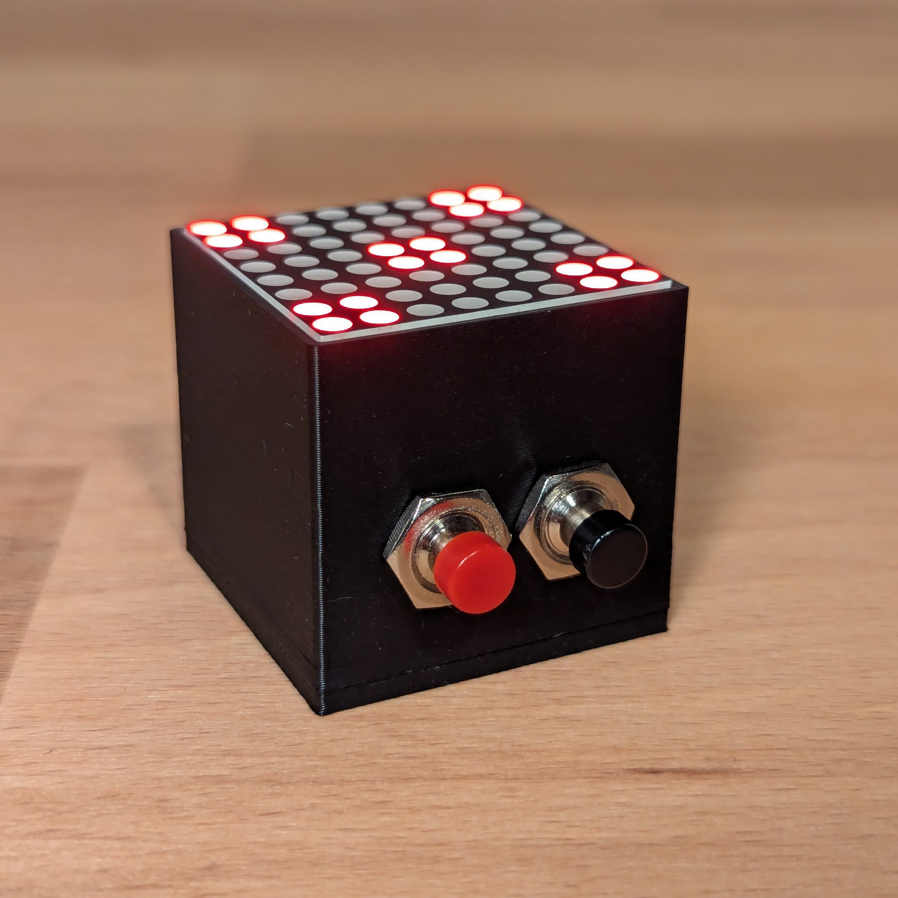
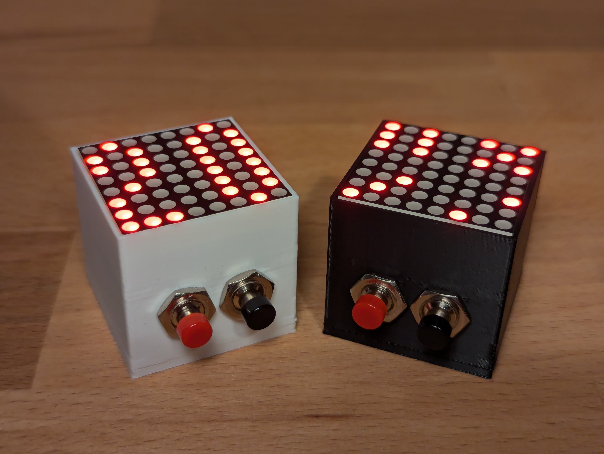
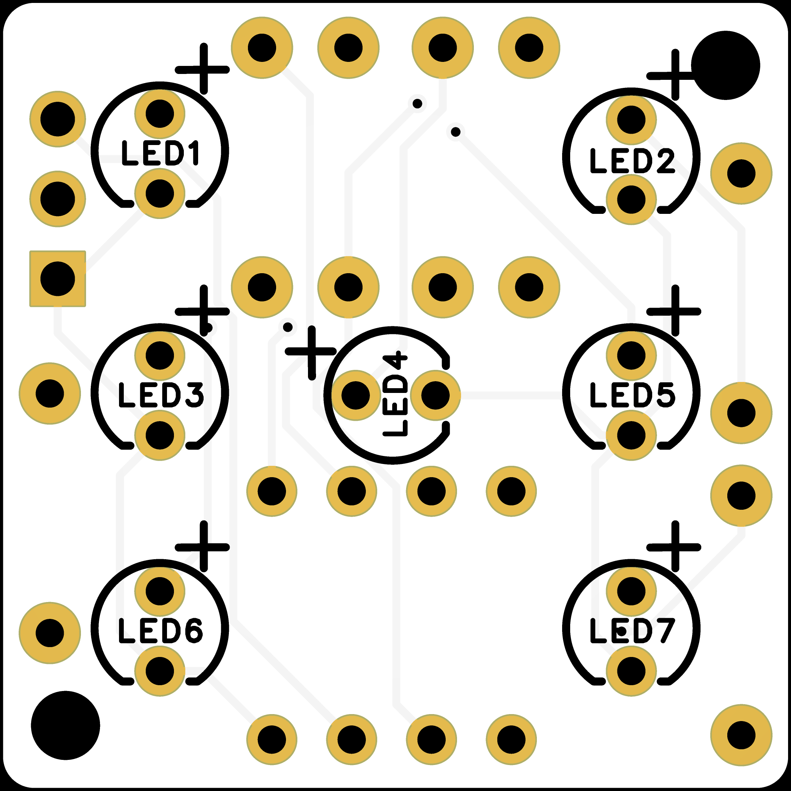
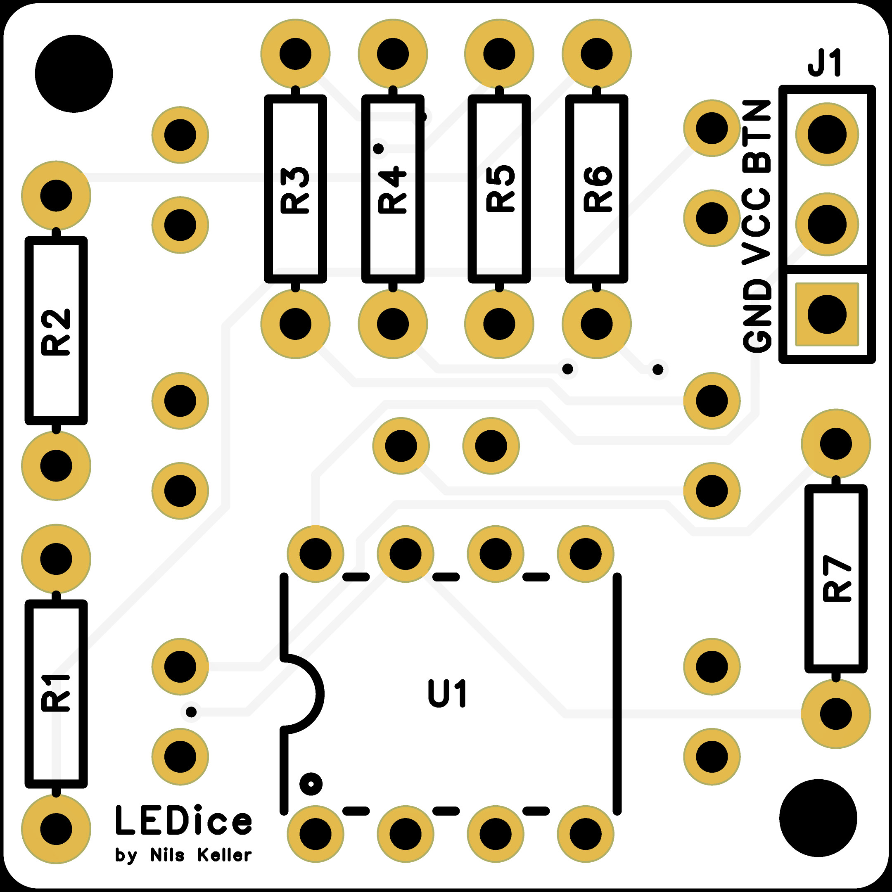
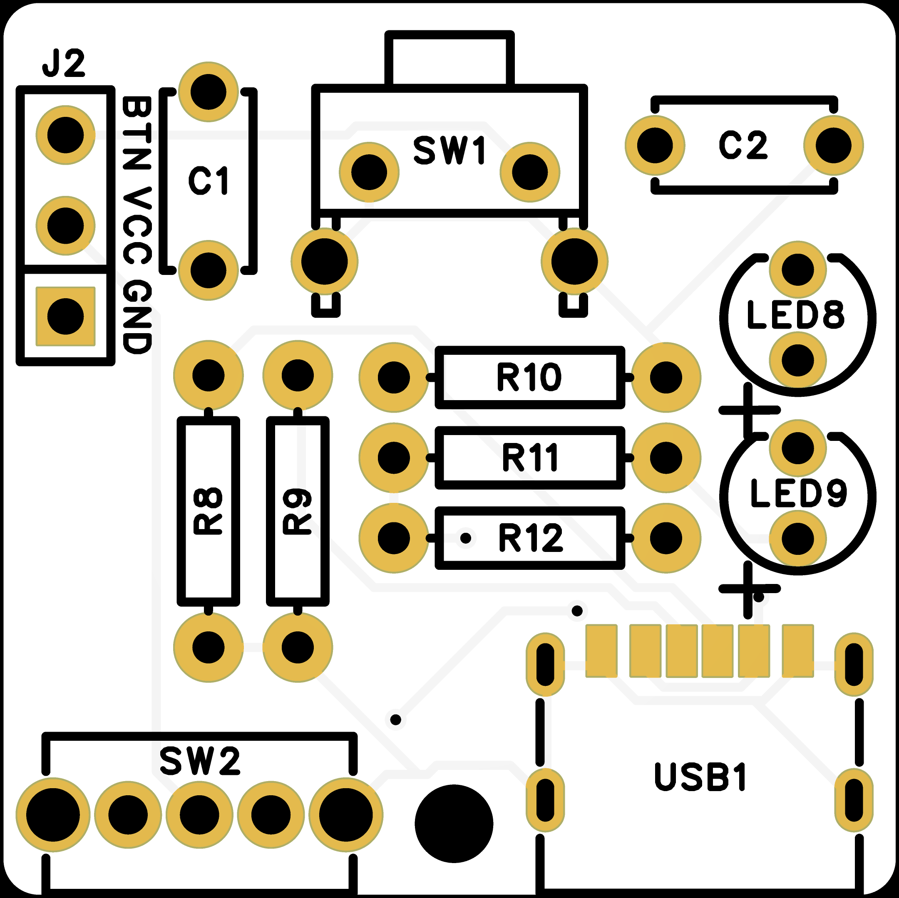
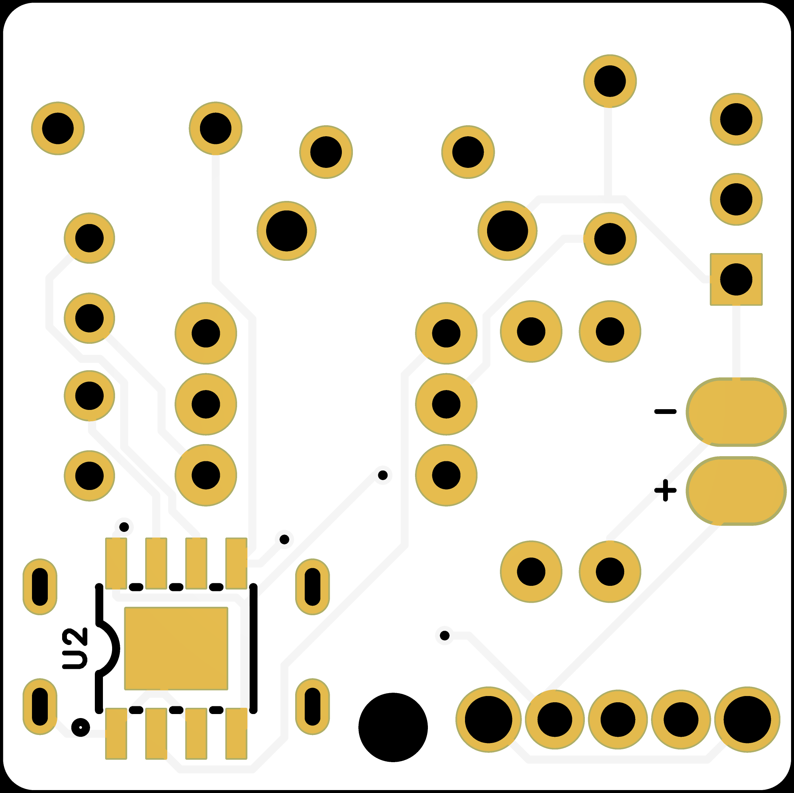

# LEDice

LEDice is a compact, LiPo battery-powered device that uses an ATtiny85 microcontroller and 7 LEDs to simulate dice rolls.

<!--  -->

## Core Features

* Simulates dice roll with a press of a button
* Reachargable battery including status lights when charging
* Compact design
  
<!--  -->

<!-- ## Battery life

The runtime is around **45 hours** on the lowest brightness level, which is most commonly used.  
At maximum brightness, battery life can decrease to about 7 hours, but this can vary significantly depending on the selected dice. -->

## Hardware

I designed two PCBs: The `Top PCB` and the `Bottom PCB`.  
The Top PCB contains the LEDs and the ATTiny85 microcontroller. It is connected to the Bottom PCB which contains the button, switch, USB-C port and TP4056 for recharging the battery.

### Top:

### Bottom:

You can use the gerber files [`Gerber_PCB_Bottom.zip`](https://github.com/tsomic/LEDice/blob/main/hardware/Gerber_PCB_Bottom.zip) [`Gerber_PCB_Top.zip`](https://github.com/tsomic/LEDice/blob/main/hardware/Gerber_PCB_Top.zip) for PCB fabrication.
The PCB dimensions are 25mm x 25mm with a thickness of 1mm.

<!-- You can find the 3D model on [MakerWorld](https://makerworld.com/en/models/964827#profileId-935173).  
The custom PCBs are optional, but you will need them if you want to use this case. -->

<!-- ### Components used

* ATtiny85 microcontroller
* CR2032 Battery
* [Battery holder that fits the holes on the PCB](https://www.ebay.com/itm/255283139517)
* [2 push buttons](https://www.ebay.com/itm/186063975695)
* [1 small switch](https://www.ebay.com/itm/186063975344)

The provided links are for reference, not necessarily the cheapest or best options for you.  
Please note, you'll need a programmer for the ATtiny85 microcontroller. -->
